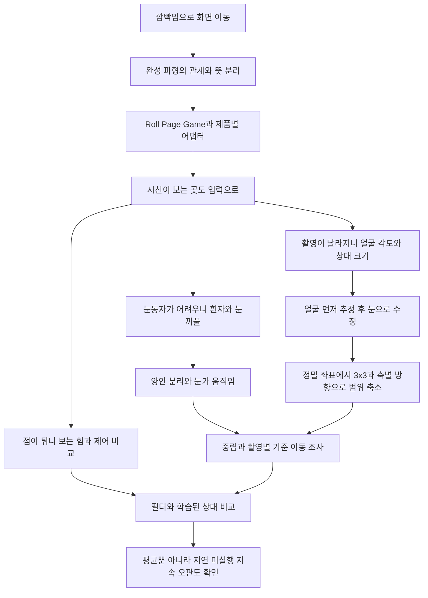

# Blink Engineering Case Study

눈을 깜빡여 휴대폰 화면을 움직이는 실험은, 눈동작의 뜻을 해석하는 엔진과 시선 연구로 이어졌습니다. 이 저장소는 **왜 만들었고, 어디서 막혔으며, 어떤 생각으로 다음 방법을 골랐는지**를 남긴 공개 개발 사례입니다.

완성한 기능만 늘어놓지 않습니다. 보는 힘, 흰자, 눈꺼풀, 얼굴 각도, 주시안, 눈가 움직임이라는 가설이 나온 이유와 실제 비교에서 남은 한계를 함께 적었습니다.

## 먼저 읽기

- [전체 개발 이야기](docs/blink-story.ko.md): 시작, 깜빡임 문법, 특허 검토, 앱 출시와 시선 연구를 시간 흐름으로 읽기
- [시선 추적 상세 이야기](docs/gaze-story.ko.md): 22개 장면으로 보는 아이디어와 실험의 변화
- [이력서 첨부용 PDF](reports/blink-project-record-ko.pdf): 프로젝트 정보표, 목차, 이야기, 기술 선택과 주장 범위를 묶은 상세 원고
- [실험 계보와 시스템 경계](docs/architecture-and-lineage.ko.md)
- [숫자를 읽는 방법과 근거](docs/evidence-and-limits.ko.md)
- [English Summary](README.en.md)

## 프로젝트 정보

| 항목 | 내용 |
| --- | --- |
| 목적 | 눈동작으로 Android 화면과 게임을 조작하고, 실제로 보는 방향을 입력으로 활용 |
| 기록 범위 | 2026년 6월부터 10월 15일까지의 개발·연구 기록 |
| 역할 | 문제 정의, 사용 경험에 따른 가설 제안, 기기 입력·재현, 우선순위와 채택 판단. 구현·실험·문서화에 AI 코딩 도구 활용 |
| 기술 | Kotlin, Android 접근성·카메라, MediaPipe, Rust, Unity/C#, Python·PyTorch/CUDA, 자체 기하 커널과 시계열 비교 |
| 제품과 연구 | BlinkRoll·BlinkPage·BlinkGame 출시 이력과 GazeLab·BlinkLine 연구를 구분 |
| 현재 기록의 결론 | 일부 입력·성능·검증 구조는 개선. 촬영이 달라져도 자연스러운 공통 시선 추적은 미완성 |

기간은 매일의 연속 근무 시간을 뜻하지 않습니다. 앱별·실험별 시점과 적용 범위는 본문을 따릅니다. 이 저장소 작성일에 새 모델 학습이나 Play 출시를 한 것은 아닙니다.

## 무엇을 배웠나

처음에는 눈을 잘 찾으면 화면도 잘 움직일 줄 알았습니다. 실제로는 관측, 동작의 해석, 실행 허용, 다른 앱의 제스처 접수까지 다른 실패 지점이 있었습니다. 시선 역시 방향 판단, 흔들림을 다루는 제어, 게임 화면의 표시를 나눠 봐야 했습니다.

대표적인 전환은 다음과 같습니다.



이는 아이디어의 관계도입니다. 모든 가지가 서로를 대체했거나 순서대로 성공했다는 뜻은 아닙니다.

## 잘된 숫자만 고르지 않기

시선 상태 모델의 한 비교는 적격 일치도 **82.01% → 86.04%**, 판정 변경 **82회 → 15회**였습니다. 그러나 오래 지속된 오판은 **12.039초 → 15.552초**로 늘었습니다. 덜 흔들리면서 더 오래 틀릴 수 있어 제품 승격을 보류했습니다.

이 값은 단일 사용자의 저장 기록에서 안내 표적과 비교한 개발 지표입니다. 실제 시선을 독립 측정한 정답이나 새 사용자 정확도가 아닙니다. 실험마다 분모가 달라 서로 다른 점수를 그대로 연결할 수도 없습니다. [실험별 조건과 수치](docs/evidence-and-limits.ko.md)

## 공개 범위

이 저장소는 제품 전체 소스나 학습 데이터 배포가 아닙니다. 얼굴·눈 사진과 영상, 실제 특징 행, 모델 가중치, 기기·계정 식별자, 원본 대화, 서명 키, 광고 계정 정보와 미출원 특허의 상세 자료는 넣지 않았습니다. 특허는 **출원 검토와 명세서·제출 후보 준비 이력**으로만 설명하며 출원·등록 완료를 주장하지 않습니다.

공개한 집계는 비공개 실험 문서에서 선별한 기록입니다. 원천 문서의 식별용 SHA-256은 제공하지만 원본 코퍼스는 공개하지 않습니다. 따라서 이 저장소만으로 모델 성능 전체를 독립 재현할 수는 없습니다. [개인정보와 공개 경계](PRIVACY.md)

## 이 저장소의 검사

Python 3.10 이상, 표준 라이브러리만으로 실행합니다.

```text
python -m unittest discover -s tests -v
python scripts/check_public_case_study.py
```

검사는 공개 파일 목록, 로컬 링크, 집계 구조와 주요 수치, 비공개 정보의 일부 패턴을 확인합니다. 과거 모델 학습·기기 시험을 다시 실행하는 명령은 아니며 개인정보 부재를 수학적으로 보증하지도 않습니다. GitHub Actions는 사용하지 않습니다.

관련 공개 개발 기록: [KullChip Engineering Case Study](https://github.com/cheolgyu/kullchip-engineering-case-study)
