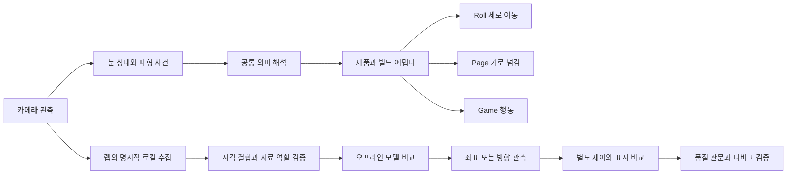

# 시스템 경계와 아이디어 계보

서로 다른 시기의 모든 구현을 하나의 현재 제품 구조로 합친 그림이 아닙니다. 공통으로 지키려 한 책임 경계를 정리했습니다.

## 제품 입력과 시선 연구를 구분

MediaPipe의 관측, 자체 방향 모델, 보는 힘 제어와 Unity 표시를 같은 모델이라고 부르지 않습니다. Roll과 Page·Game의 수집 경로 차이도 남아 있어 공통 모듈을 쓴다는 말만으로 모든 실행이 같다고 가정하지 않습니다. 연구 수집과 미채택 모델은 제품에 자동 유입되지 않게 구분합니다.

## 실험 계보

| 기간 | 질문과 범위 | 남은 결과 |
| --- | --- | --- |
| 2026년 6월 | 브라우저 깜빡임 실험 | 모바일 HTTPS·카메라 준비와 당시 미해결 깜빡임→스크롤 연결을 구분 |
| 2026년 7월 | 눈 입력 문법과 특허 준비 | 시간 하나 대신 파형 관계, 뜻과 실행 분리, 출원 검토·자료 준비 |
| 2026년 7월 말부터 8월 | Roll·Page·Game으로 확장 | 공통 입력과 제품별 행동, 앱별 수집·실행 경계 정리 |
| 2026년 8월 | 전체 화면과 보는 힘 | 테두리 보정·전체 격자·직접 좌표와 제어 비교 |
| 2026년 8월 말부터 9월 | Line과 시선 문맥 | 줄 위치·전달 지연·폰 자세·화면 안팎 실험 분리 |
| 2026년 10월 8일 | 관측과 단서 재검토 | 얼굴 자세 추정값 누락 수정, 얼굴 우선·눈꺼풀·오차 분해 |
| 2026년 10월 9일부터 13일 | 좌우·상하와 공통 모델 | 목표 축소, 눈가·자체 커널·양안 분리·중립·촬영 전이 비교 |
| 2026년 10월 13일부터 15일 | 시간축과 체감 검증 | 원본·필터·상태 모델의 안정성·지연·미실행·지속 오판 비교 |

## 구체적인 문제와 선택

| 문제 | 선택한 방법 | 확인 범위와 한계 |
| --- | --- | --- |
| 자연 깜빡임과 의도 입력이 비슷함 | 완성 파형과 유지·재열림 관계를 읽는 문법 | 기기·사용자 차이의 일부 실패는 남음 |
| 표시가 감김인데 화면이 안 움직임 | 관측·문법·실행 허용·접근성 접수를 따로 추적 | 표시 성공을 종단 성공으로 세지 않음 |
| 앱과 시험판마다 의미가 달라짐 | 공통 의미 해석과 제품·빌드 어댑터 분리 | 파일 공유만으로 경로 일치를 가정하지 않음 |
| 시선 좌표가 들쭉날쭉함 | 보는 힘과 탄성 추종 비교 | 안정화와 원시 좌표 정확도는 별개 |
| 눈동자를 찾기 어려움 | 흰자·밝기·경계와 눈꺼풀 가설 비교 | 흰자 정답 분할·깜빡임 구별 완성 아님 |
| 거리와 자세가 달라짐 | 상대 눈 크기·폰 자세·얼굴 자세 추정값을 구분 | 상대 크기는 cm 단위 거리, 얼굴 각도는 물리 정답이 아님 |
| 작은 눈만으로 단서가 부족함 | 얼굴 먼저 추정 후 눈으로 수정 | 조건별 이득과 퇴행이 공존해 미채택 |
| 양쪽 눈을 섞으면 차이가 사라짐 | 한쪽 눈·평균·양안 분리 커널 비교 | 의학적 주시안 판정 아님 |
| 중립 기준이 촬영마다 달라짐 | 촬영 전체 제외 평가와 중립 입력 진단 | 촬영별 분포 이동은 확인, 물리적 원인 미확정 |
| 필터가 정상 입력도 늦춤 | 흔들림·추가 지연·새 미실행·지속 오판 동시 평가 | 평균이 높아도 품질 관문 실패면 보류 |
| 다른 앱과 함께 쓰면 버벅임 | 대기 작업 예산과 Rust 동일 결과 변환 | 특정 연산 개선이지 전체 발열 해결 아님 |
| 출시 후 시험판과 다르게 느껴짐 | 동일 AAB 승격과 기기 설치 지문 확인 | 같은 파일이어도 입력 조건의 차이는 남음 |

## 이력서에 옮길 때 구분할 표현

| 피할 표현 | 정확한 표현 |
| --- | --- |
| 시선 정확도 93.78%를 달성했다 | 특정 세 촬영의 조건부 개발 점수다. 관측 없는 방문 포함 시 88.37%이며 새 사용자 정확도가 아니다. |
| 흰자를 인식해 시선 추적을 완성했다 | 흰자 변화 가설과 명암·경계 입력을 비교했다. 정답 마스크를 갖춘 흰자 분할 성공은 미확인이다. |
| 눈 근육의 수축을 측정했다 | 눈가의 영상 모양과 움직임을 시험했다. EMG나 특정 근육 활성 측정은 아니다. |
| 사용자의 주시안을 자동으로 찾았다 | 한쪽 눈과 양안 결합 방식을 비교했다. 의학적 주시안은 확정하지 않았다. |
| 필터로 흔들림 문제를 해결했다 | 일부 흔들림 감소와 지연·오판의 손실을 함께 확인했으며 자동 채택하지 않았다. |
| Rust로 앱이 61.9% 빨라졌다 | SM-S의 특정 영상 변환 계산 시간이 약 61.9% 감소했다. 전체 앱 속도나 발열 개선율이 아니다. |
| 눈감김 문법 특허를 출원·등록했다 | 선행기술 검토, 명세서와 제출 후보 준비까지 확인했다. 접수·등록 완료 증거는 확인하지 않았다. |
| 시선 기능을 게임 정식판에 완성했다 | 실험과 디버그 적용을 분리했고 준비되지 않은 Stage 2는 프로덕션 공개 범위에서 제외했다. |

이 기록은 제품의 성공 인증서가 아닙니다. 준비되지 않은 시선 Stage 2의 정식 공개를 정당화하지 않습니다. 특허도 검토·준비 이력과 실제 출원·등록을 구분합니다.
